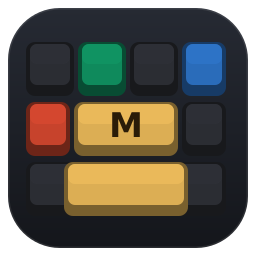
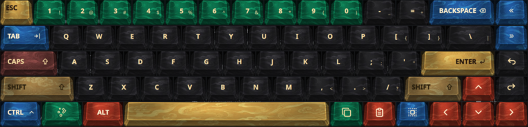
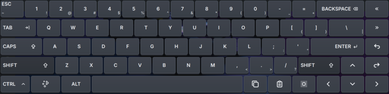
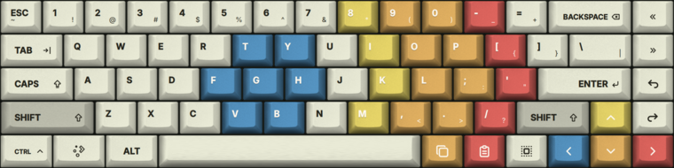
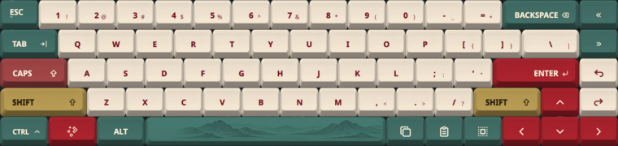
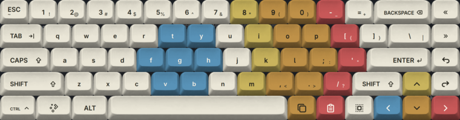
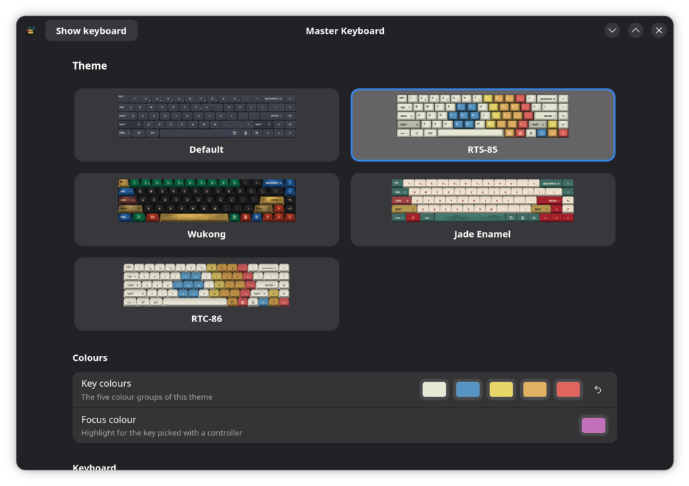

# Master Keyboard for Plasma

Themes and a better layout for the **Plasma 6 on-screen keyboard**, for Desktop Mode on Bazzite, SteamOS and other KDE Plasma systems.

Looking for Gaming Mode? That is the [Master Keyboard Decky plugin](https://github.com/soullegacyvn-ux/Master-Keyboard).



## What you get

**Free**

- The Master Keyboard layout: Ctrl and Alt, Copy, Paste, Select All, Undo and Redo, arrow keys, Home and End.
- A plain Default look.
- Adjustable height, key colours, focus colour, see-through background and typing sound.



**Premium** (one payment of $4.99 USD)

| RTS-85 | Jade Enamel | RTC-86 |
|---|---|---|
|  |  |  |

One purchase covers this edition and the Decky plugin on the same device.

## Install

1. Download `master-keyboard-plasma-<version>.tar.gz` from [Releases](../../releases/latest) and extract it.
2. In the extracted folder, run:

   ```sh
   sh install.sh
   ```

3. Open **Master Keyboard Settings** from the application menu.

Everything is installed in your home folder. To remove it, run `sh uninstall.sh` from the same folder; your previous on-screen keyboard is restored.

## Settings



Pick a theme, change the five key colour groups, and set height, background and sound. Changes apply right away.

## Premium

- **Buy** in the settings window. Pay with PayPal by scanning the QR code or in your browser; the window unlocks by itself.
- **Have a license key?** Choose *I have a license key* and enter the key from your receipt.
- **Bought in the Decky plugin?** On the same device the themes unlock automatically.

## Requirements

- Plasma 6 on Wayland with `plasma-keyboard`
- Qt 6.10 or newer
- `python3`. Premium themes also need `python3-pillow`. The settings window uses GTK 4 and libadwaita, and falls back to a simple menu without them.
- Ctrl and Alt shortcuts on the keyboard need `ydotool`.

Tested on Bazzite 43. Other systems may work but are untested. If a Plasma update stops the theme from loading, Plasma's own keyboard is used until this package is updated.

## Support

Write to soullegacyvn@gmail.com and include your receipt email if the question is about a purchase.
